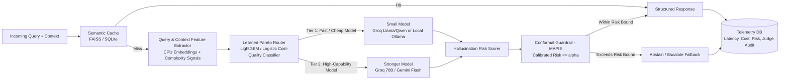

# Conformal Hallucination Control & Learned LLM Cost-Quality Router

> **Status:** Implemented (Phases 1–4 complete: offline feature extraction, conformal risk calibration, Pareto router training, FastAPI gateway, SvelteKit monitoring console, and Docker Compose stack verified). Automated LLM-as-a-Judge audit remains `TBD` until `DEEPSEEK_API_KEY` or `GROQ_API_KEY` is configured.

A **Statistical AI Control & LLMOps** platform that applies **Conformal Prediction**, **Bias-Corrected Evaluation**, and **Cost-Quality Routing** to make production LLM/RAG systems mathematically reliable and cost-efficient.

While many AI projects stop at building a RAG pipeline or agent wrapper, enterprise AI teams face two harder production bottlenecks: **unbounded hallucination risk** and **runaway token costs**. This project solves both by treating LLM orchestration as a measurable data science and risk-control problem.

---

## Why This Matters in Industry

1. **Uncalibrated LLM Confidence:** Raw LLM outputs and naive cosine-similarity thresholds provide no mathematical guarantee on error rates. Using **Split Conformal Prediction / Conformal Risk Control**, the gateway provides a tunable risk guarantee (e.g., $\le \alpha$ false-acceptance rate) and triggers **calibrated abstention** or human escalation when uncertainty is high.
2. **Naive Single-Model Routing:** Sending every query to a frontier model wastes 60-80% of inference spend on simple queries. A **Learned Pareto Router** routes easy queries to lightweight/cheap models and escalates complex queries only when predicted quality gain justifies the cost.
3. **Noisy Automated Judges:** Standard *LLM-as-a-Judge* metrics suffer from verbosity and position bias. This project benchmarks and corrects judge bias against human-annotated ground truth before trusting automated evals.

---

## Architecture



Two core workflows:

1. **Offline Statistical Eval & Calibration Pipeline:** Bias-corrected judge calibration, hallucination risk modeling + conformal threshold calibration (`MAPIE`), and multi-LLM Pareto router training on `RAGTruth` and `RouterBench`.
2. **Online AI Inference Gateway:** Semantic caching, learned model routing, conformal hallucination gating, structured telemetry logging, and live Pareto / calibration monitoring.

---

## Datasets & Free Resources

Offline training, statistical calibration, and large-scale benchmarking require **zero paid tokens** using public benchmark datasets. Live gateway demos run on **free-tier APIs** and/or local CPU/Ollama models.

| Resource | Details | License / Cost |
|---|---|---|
| **`RAGTruth`** | ~18,000 LLM responses (~15,090 train / ~2,700 test) with span-level human annotations for hallucinations across QA, summarization, and data-to-text (`ParticleMedia/RAGTruth` / `wandb/RAGTruth-processed`). | **MIT License** (free) |
| **`RouterBench`** | >405,000 multi-LLM inference outcomes with quality scores and cost metadata (`withmartian/routerbench` on Hugging Face & GitHub). Enables training and Pareto evaluation of routers at zero API cost. | Open Benchmark (free) |
| **Statistical & ML Stack** | `MAPIE` (BSD 3-Clause), `scikit-learn`, `LightGBM`, `sentence-transformers` (CPU embeddings e.g. `all-MiniLM-L6-v2`), `FAISS` | 100% Open Source |
| **Live Demo Inference** | **Groq Free Tier** (~30 RPM, ~1,000 RPD, ~8k TPM / ~200k TPD per model) for fast small-vs-large open models; optional **Gemini API Free Tier** (~5-15 RPM, ~20-1,500 RPD depending on Flash/Flash-Lite; note Google free-tier inputs may be reviewed for product improvement) or **local Ollama** | **Free** (within rate limits; avoid sensitive data on free cloud tiers) |
| **Serving & UI** | `FastAPI`, `Pydantic`, `SQLite` / `PostgreSQL`, `Docker`, `Streamlit` or `SvelteKit` | 100% Open Source |

---

## Data Science & Statistical Methodology

### 1. Bias-Corrected LLM-as-a-Judge Audit
- Evaluate automated judge agreements against human labels in `RAGTruth` using **Cohen's Kappa**, **Spearman correlation**, and confusion matrices across task types (QA, summarization, data-to-text).
- Quantify and correct **verbosity bias** and **position bias** via length-controlled regression / calibration adjustment.

### 2. Hallucination Risk Modeling & Conformal Risk Control (`MAPIE`)
- **Feature Engineering (CPU-friendly):** Retrieval-to-answer cosine similarity (`sentence-transformers`), NLI entailment / contradiction score between retrieved passages and generated claims, token/length ratios, named-entity overlap rate, and query ambiguity indicators.
- **Base Risk Classifier:** Train calibrated `LightGBM` / `LogisticRegression` predictors on `RAGTruth` to estimate $P(\text{hallucination} \mid \text{query, context, response})$.
- **Conformal Calibration (`MAPIE`):** Apply **Split Conformal Prediction / Conformal Risk Control** on a held-out calibration split to choose threshold $\hat{\lambda}(\alpha)$ ensuring empirical hallucination pass-through stays bounded at target risk level $\alpha$ (e.g. 5% or 10%), measuring:
  - **Empirical Miscoverage / False-Accept Rate** vs. target $\alpha$.
  - **Abstention Rate** (efficiency trade-off: how many responses must be held back to achieve safety $\alpha$).
  - **Calibration Metrics:** Expected Calibration Error (ECE) and Brier Score.

### 3. Learned Cost-Quality Router (`RouterBench`)
- Train routing models (predictive performance-cost score vs. cascading router) to choose between cheap/small models and expensive/strong models per query.
- Evaluate across the full **Pareto Frontier**:
  - **Cost Reduction (%)** at fixed quality retention (e.g., retaining $\ge 95\%$ of frontier-model accuracy).
  - **Area Under Cost-Quality Curve (AUC-QC)** vs. random routing and always-strong / always-weak baselines.
  - **Out-of-Domain Generalization:** Hold out specific task categories during training to test router robustness under query distribution shift.

---

## AI Engineering & Serving Layer

### FastAPI Gateway Endpoints
- `POST /v1/query`: Executes semantic cache lookup -> learned router tier selection -> LLM call (Groq/Ollama/Gemini) -> conformal hallucination scorer -> returns `{answer, model_used, estimated_cost, calibrated_risk_score, conformal_decision: "PASS" | "ABSTAIN", latency_ms}`.
- `POST /v1/evaluate-risk`: Standalone conformal guardrail endpoint to score and gate any `(query, context, candidate_answer)` tuple.
- `GET /v1/telemetry/pareto`: Aggregates logged requests to compare realized cost savings, abstention rate, latency `p50/p95`, and cache hit rate.
- `GET /health`: Checks model artifacts, embedding model readiness, cache backend, and upstream provider reachability.

### Guardrails & Production Reliability
- **Graceful Rate-Limit Fallback:** Automatic fallback across free-tier providers or cached responses when hitting `429` rate limits during demos.
- **Strict Pydantic Contracts:** Typed telemetry, deterministic config snapshots, and reproducible conformal calibration artifacts (`calibrator.pkl`).

### Dashboard
- **Pareto Frontier Explorer:** Interactive plot of cost vs. quality across routing thresholds ($\lambda_{\text{cost}}$).
- **Conformal Reliability & Risk Control View:** Slider for target error bound $\alpha$ showing live impact on false-accept rate and abstention rate.
- **Audit Log Inspector:** Inspect flagged/abstained responses alongside retrieved context overlap scores.

---

## Proposed Repository Structure

```text
conformal-llm-router/
├── config/
│   ├── ragtruth_conformal.yaml      # Conformal calibration & feature config
│   └── routerbench.yaml             # Cost-quality router training config
├── data/
│   ├── raw/                         # RAGTruth & RouterBench downloads (gitignored)
│   └── processed/                   # Extracted feature tables in Parquet
├── notebooks/
│   ├── 01_judge_bias_audit.ipynb    # LLM-as-a-Judge agreement & bias correction
│   ├── 02_conformal_guardrail.ipynb # Risk classifier, ECE, MAPIE risk control curves
│   └── 03_pareto_router.ipynb       # RouterBench training & out-of-domain shift eval
├── src/
│   ├── eval/
│   │   ├── judge_audit.py           # Cohen's Kappa, Spearman, bias regression
│   │   └── features.py              # Embedding similarity, entity overlap, NLI scores
│   ├── conformal/
│   │   ├── risk_model.py            # Base hallucination risk estimator
│   │   └── calibrator.py            # MAPIE split conformal & risk-control calibration
│   ├── router/
│   │   ├── trainer.py               # Cost-quality router training & threshold tuning
│   │   └── pareto.py                # Pareto frontier & AUC-QC evaluation
│   └── gateway/
│       ├── main.py                  # FastAPI inference & guardrail gateway
│       ├── cache.py                 # FAISS/SQLite semantic cache
│       ├── providers.py             # Groq / Gemini / Ollama unified async clients
│       └── schemas.py               # Pydantic request/response/telemetry models
├── dashboard/                       # Streamlit or SvelteKit Pareto & calibration UI
├── tests/
│   ├── test_conformal.py            # Empirical coverage & abstention boundary tests
│   ├── test_router.py               # Routing constraint & fallback tests
│   └── test_gateway.py              # FastAPI endpoint, cache hit, & 429 fallback tests
├── Dockerfile
├── pyproject.toml
└── README.md
```

---

## Quickstart (Local & Docker Compose)

### Option A: Docker Compose (Gateway + Dashboard)

```sh
cp .env.example .env   # optional: add DEEPSEEK_API_KEY / GROQ_API_KEY / GEMINI_API_KEY
docker compose up --build
```

- FastAPI Gateway: `http://localhost:8000` (health check: `GET /health`, docs: `/docs`)
- SvelteKit Monitoring Console: `http://localhost:3000`

### Option B: Local Development (`uv` + `npm`)

```sh
# 1. Start the FastAPI inference & guardrail gateway
uv sync --frozen
uv run uvicorn src.gateway.main:app --host 0.0.0.0 --port 8000 --reload

# 2. Start the SvelteKit monitoring dashboard (in a separate terminal)
npm --prefix dashboard install
npm --prefix dashboard run dev
```

Run tests & checks:

```sh
uv run pytest -v
uv run ruff check src/ tests/
npm --prefix dashboard run check && npm --prefix dashboard test
```

---

## Experiment Results (Measured Phase 2–3 Runs)

### Judge Bias Audit (`RAGTruth`)

- **Status:** `TBD` (`sample_size: 0` / `requested_sample_size: 300` in `artifacts/judge_audit_summary.json`; requires `DEEPSEEK_API_KEY` or `GROQ_API_KEY` in `.env` to run live automated judge scoring).

### Conformal Hallucination Control (`RAGTruth` Test Split, $n_{\text{test}} = 2{,}700$)

Split sizes: `train = 12,072`, `cal = 3,018`, `test = 2,700` (from `artifacts/risk_metrics.json`).

| Guardrail Method | Target Risk $\alpha$ | Empirical False-Accept Rate | Abstention Rate | Brier Score |
|---|---|---|---|---|
| Uncalibrated Heuristic Threshold (`0.50`) | N/A | 13.52% (`0.1352`) | 34.52% (`0.3452`) | 0.1963 |
| Logistic + Split Conformal (MAPIE) | 0.10 | 4.67% (`0.0467`) | 65.37% (`0.6537`) | 0.1894 |
| Logistic + Split Conformal (MAPIE) | 0.05 | 2.33% (`0.0233`) | 76.59% (`0.7659`) | 0.1894 |
| LightGBM + Split Conformal (MAPIE) | 0.10 | 4.15% (`0.0415`) | 63.15% (`0.6315`) | 0.1734 |
| LightGBM + Split Conformal (MAPIE) | 0.05 | 1.96% (`0.0196`) | 74.93% (`0.7493`) | 0.1734 |

- **Calibration ECE:** Uncalibrated Heuristic `0.0650`, Logistic `0.0775`, LightGBM `0.0761`. Both conformal guardrails strictly satisfy empirical false-accept rate $\le \alpha$ at $\alpha \in \{0.05, 0.10\}$, with LightGBM achieving lower abstention and Brier score than Logistic.

### Cost-Quality Routing (`RouterBench`, $n_{\text{test}} = 7{,}214$)

Split sizes: `train = 21,642`, `test = 7,214`, OOD holdout (`mbpp`) `= 427` (from `artifacts/pareto_sweep.json`).

| Routing Strategy | Avg Quality Score | Avg Cost vs. Frontier (%) | Cost Savings (%) |
|---|---|---|---|
| Always Frontier Model | 0.7780 | 100.00% | 0.00% |
| Always Small Model | 0.3071 | 1.43% | 98.57% |
| Random Router | 0.5373 | 49.93% | 50.07% |
| Learned Pareto Router ($\lambda_{\text{cost}} = 0.45$) | 0.7480 | 91.50% | 8.50% |

- **Pareto Summary:** In-domain `AUC-QC = 0.5206` and **8.50%** cost savings at $\ge 95\%$ frontier quality (`0.7480 / 0.7780 = 96.14%` quality retention at $\lambda_{\text{cost}} = 0.45$). On the held-out OOD `mbpp` task (`n = 427`), `AUC-QC = 0.5148` with **3.07%** cost savings at $\ge 95\%$ frontier quality.

---

## Implementation Milestones

1. **Phase 1: Benchmark Ingestion & Feature Extraction:** Download `RAGTruth` and `RouterBench`; compute CPU-friendly semantic/overlap risk features into Parquet.
2. **Phase 2: Judge Audit & Conformal Calibration:** Run judge-bias analysis; train hallucination risk classifiers and calibrate finite-sample risk guarantees with `MAPIE`.
3. **Phase 3: Learned Pareto Router:** Train cost-quality routers on `RouterBench`, measure out-of-domain robustness, and plot Pareto frontiers.
4. **Phase 4: Inference Gateway, UI & Tests:** Build FastAPI gateway with semantic caching + live Groq/Gemini/Ollama routing + conformal abstention, add unit/API tests, and populate benchmark tables.
